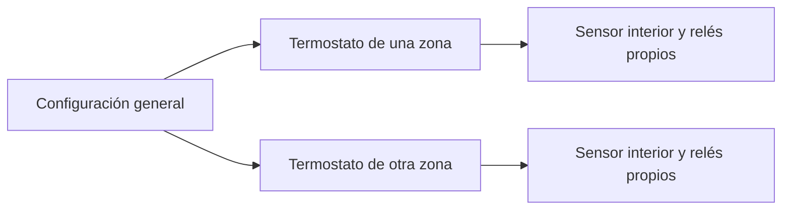

  

# Radiant Climate

**Tus sensores y relés, convertidos en termostatos de calor y frío.**

Una integración para Home Assistant con perfiles, horarios y funciones opcionales por habitación. Diseñada con especial atención al suelo radiante/refrescante, su inercia y las instalaciones con una válvula de entrada compartida.

> **Versión: v0.2.10.** Probada con Core 2026.10.4 y 2026.11.0.
> Proyecto personal de código abierto. No es un controlador certificado; la respuesta térmica debe ajustarse a cada instalación. La refrigeración requiere protección anticondensación independiente.

**Empieza aquí:** [Instalar](#1-instalar) → [Crear termostatos](#2-crear-la-instalación-y-las-zonas) → [Configurar](#3-configurar-perfiles-y-horarios) → [Usar](#4-uso-diario-manual-y-apagado).

<strong>Índice completo</strong>

- [Qué puedes hacer](#qué-puedes-hacer)
- [Antes de empezar](#antes-de-empezar)
- [1. Instalar](#1-instalar)
- [2. Crear la instalación y las zonas](#2-crear-la-instalación-y-las-zonas)
- [3. Configurar perfiles y horarios](#3-configurar-perfiles-y-horarios)
- [4. Uso diario: Manual y Apagado](#4-uso-diario-manual-y-apagado)
- [5. Activar funciones opcionales](#5-activar-funciones-opcionales)
- [6. Configurar el aporte solar](#6-configurar-el-aporte-solar)
- [7. Vacaciones, nuevas zonas y cambio de relés](#7-vacaciones-nuevas-zonas-y-cambio-de-relés)
- [8. Organizar el panel](#8-organizar-el-panel)
- [Problemas y soluciones](#problemas-y-soluciones)
- [Actualizar y volver atrás](#actualizar-y-volver-atrás)
- [Validación y límites](#validación-y-límites)
- [Guías, soporte y licencia](#guías-soporte-y-licencia)

## Qué puedes hacer

| Para… | Utiliza… |
|---|---|
| Mantener una temperatura | Consigna fija, calefacción o refrigeración |
| Cambiar según la hora | Perfiles Normal, Eco, Noche y Ausente; agenda semanal por zona |
| Tener más confort puntualmente | Manual por tiempo, hasta el próximo bloque o indefinido |
| Ventilar | Contacto de ventana con retardos al abrir y cerrar |
| Adaptar el aporte | Aprendizaje, anticipación del horario e inercia, activables por separado |
| Aprovechar el sol | Observación u optimización solar por orientación y sombras de cada zona |
| Ausentarte | Vacaciones de vivienda con fecha y hora de regreso |
| Entender una parada | Motivo de regulación y diagnóstico de fuentes, modelo y relés |
| Observar el agua | Diagnóstico hidráulico opcional con sondas de impulsión y retorno |

**No requiere ayudantes, scripts ni automatizaciones externos.** La integración crea y conserva sus propios controles. No depende de Dual Smart Thermostat ni Versatile Thermostat.

Cada termostato puede ser tan sencillo o completo como necesites. Por ejemplo, un baño puede usar horario y aprendizaje sin ventana ni sol; otra estancia puede añadir los módulos solares.

## Antes de empezar

Necesitas una temperatura interior válida en **°C** y uno o varios relés con entidad **`switch`** por zona. Una salida solo puede pertenecer a una zona o a la general.

| Componente | ¿Obligatorio? | Qué seleccionar |
|---|---|---|
| Sensor interior | Sí | Temperatura representativa de la habitación |
| Relé o relés | Sí | Salidas que abren sus circuitos; comparten consigna |
| Válvula general | No | Entrada común de agua, si existe |
| Ventana | No | Contacto `binary_sensor` de esa zona |
| Temperatura exterior | No | Sensor exterior protegido del sol directo |
| Meteorología | No | Entidad `weather` del proveedor que elijas |
| Posición solar | Solo para Solar | Sol de HA o una fuente alternativa compatible |
| Impulsión y retorno | No | Sondas generales, solo para diagnóstico |

**Antes de asignar salidas reales:** conserva una copia recuperable y detén los controladores y automatizaciones que ya las gobiernan. Radiant Climate apagado también puede solicitar cierres; no compartas una salida con otro controlador activo. Prueba primero en un entorno aislado.

El control básico es local y no solicita cuentas propias. Tu proveedor meteorológico puede depender de Internet. No se incorpora telemetría propia.

## 1. Instalar

### Core 2026.11.0 · Marketplace

1. Abre **Configuración → Marketplace → Añadir desde enlace**.
2. Introduce `https://github.com/Carbanog/radiant-climate`.
3. Selecciona **v0.2.10** e instala; es una release normal.
4. En una instalación nueva, Marketplace abre el asistente de configuración.

Este recorrido se ha comprobado en el laboratorio con 2026.11.0. El acceso al repositorio puede requerir la conexión con GitHub gestionada por Marketplace. Una actualización puede pedir reiniciar HA.

### Core 2026.10.4 · HACS

1. Con HACS configurado, abre **Repositorios personalizados** en su menú.
2. Añade `https://github.com/Carbanog/radiant-climate`, categoría **Integración**.
3. Descarga **v0.2.10** y reinicia Home Assistant.
4. Abre **Configuración → Dispositivos y servicios → Añadir integración → Radiant Climate**.

No necesitas mostrar versiones preliminares. El proyecto se añade por enlace; no se afirma su inclusión en el catálogo oficial. Para ZIP, integridad y recuperación, consulta [Instalación y reversión](docs/installation.md).

## 2. Crear la instalación y las zonas

### A. Configuración general · una vez

La primera pantalla permite seleccionar la **Válvula general**. Déjala vacía si no existe. Se crean los controles **Climatización**, **Temporada de suministro declarada** y **Vacaciones de la vivienda**.

En **Configurar → Dispositivos y regulación** puedes añadir exterior, meteorología y tiempos estimados de maniobra de la general. **0 significa desconocido**, no apertura instantánea. Declara la temporada que realmente suministra tu instalación; no se detecta automáticamente si llega agua caliente o fría.

### B. Un termostato por zona

Añade otra entrada de Radiant Climate con **Añadir hub** o **Añadir integración**, según la pantalla de HA. El asistente pide:

1. **Sensor de temperatura interior**.
2. **Relé o relés** de esa zona.
3. **Modos disponibles**: calor, frío o ambos.
4. **Temperatura deseada inicial**.

Revisa el nombre y asigna el área desde HA. Repite para cada zona. Varios relés en una zona comparten la misma temperatura; para consignas independientes, crea termostatos distintos con sensores adecuados.

### C. Revisar antes de encender

En **Configurar → Dispositivos y regulación** de cada zona revisa contacto de ventana, histéresis, mínimos activo/inactivo y antigüedad máxima del dato interior. Ajusta los tiempos a tus dispositivos: los valores iniciales no son una recomendación universal.

La caducidad usa el último informe registrado por HA, no el último cambio de valor. Una temperatura constante no demuestra que el sensor esté comunicando. [Detalles sobre sensores y caducidad](docs/configuration.md#caducidad-y-sensores-mqtt).

**La instalación y las zonas empiezan apagadas.** Tras revisar la configuración, selecciona un modo en la zona y activa **Climatización**. Observa **Motivo de regulación** y los estados comunicados de las salidas.

## 3. Configurar perfiles y horarios

### Temperaturas de cada perfil

Abre el dispositivo del termostato y busca sus controles de **Configuración**:

| Perfil | Calefacción | Refrigeración |
|---|---|---|
| Normal | `Calor · Normal` | `Frío · Normal` |
| Eco | `Calor · Eco` | `Frío · Eco` |
| Noche | `Calor · Noche` | `Frío · Noche` |
| Ausente | `Calor · Ausente` | `Frío · Ausente` |

Edita los valores desde el panel o la ficha del dispositivo. No se duplican en ayudantes. Puedes utilizar solo los perfiles que te interesen; los iniciales son orientativos.

### Ejemplo: Normal de 07:00 a 23:00, Noche el resto

En **Configurar** de la zona:

| Acción | Días | Hora de inicio | Perfil |
|---|---|---|---|
| Añadir bloque horario | Semana completa | 07:00 | Normal |
| Añadir bloque horario | Semana completa | 23:00 | Noche |

Después activa **Usar horario** en ese termostato.

Cada bloque dura hasta el siguiente, también al pasar de día. No necesita hora de fin. El mismo perfil usa su temperatura de calor o frío según la temporada. Estas horas son un ejemplo, no una recomendación térmica para todas las viviendas.

- **Añadir** en un día y hora existentes sustituye su perfil.
- **Editar bloque horario** permite cambiar días, hora y perfil, conservando los días no seleccionados.
- **Eliminar bloque horario** permite borrar todos sus días o solo algunos. Desactiva Usar horario antes de eliminar el último bloque.
- Los selectores ofrecen **Semana completa, Entre semana, Fin de semana y días individuales**.

Para repetir una agenda usa la acción **Copiar ajustes de Radiant Climate**, seleccionando solo Programación. Cada zona mantiene después su propio programa. [Agenda, cambio de hora y ejemplos](docs/configuration.md#agenda-semanal).

## 4. Uso diario: Manual y Apagado

| Quieres… | Qué hacer | Resultado |
|---|---|---|
| Un termostato convencional | Desactivar Usar horario y las optimizaciones | Consigna fija sin vencimiento |
| Seguir la agenda | Activar Usar horario | Aplica el perfil vigente; no enciende una zona apagada |
| Cambiar puntualmente | Cambiar la temperatura con agenda o Ausente activos | Inicia Manual, incluso si coincide con un perfil |
| Terminar Manual | Pulsar **Volver al horario** | Recupera la agenda vigente o Ausente si continúa activo |
| Parar una habitación | Seleccionar **Apagado** en su termostato | Permanece apagada hasta encenderla expresamente |
| Parar toda la vivienda | Apagar **Climatización** | Suspende todas las zonas y conserva sus intenciones |

### Elige cuánto dura Manual

En los controles de la zona configura **Comportamiento de Manual**:

| Opción | Cuándo termina |
|---|---|
| Durante el tiempo configurado | Al vencer **Duración de Manual**, desde la última intervención |
| Hasta el próximo cambio de horario | Al comenzar el siguiente bloque |
| Manual indefinido (sin límite de tiempo) | Al reanudar expresamente; también termina con un cambio real de temporada |

**Ejemplo:** con duración de cuatro horas, un cambio a las 21:30 sigue hasta las 01:30, aunque Noche empiece a las 23:00. Cuatro horas es un ajuste editable, no una estimación aprendida del tiempo de calentamiento del suelo.

Manual prevalece sobre las optimizaciones; Apagado, ventanas habilitadas y protecciones pueden suspender el aporte. Sus plazos siguen transcurriendo durante una parada. Cambiar la preferencia de Manual no modifica una retención ya iniciada.

**Apagado no es una retención temporal.** Ni el siguiente bloque ni el vencimiento de Manual encienden una zona apagada. Reactivar Climatización respeta las zonas apagadas individualmente. [Prioridades completas](docs/configuration.md#perfiles-y-manual).

## 5. Activar funciones opcionales

Configura primero las fuentes en la entrada general. Cada zona puede sustituir exterior y meteorología en **Entorno, sol y anticipación**; campos vacíos heredan las fuentes generales.

Después activa únicamente los controles que necesites en el dispositivo de cada zona:

| Control | Qué aporta | Requisitos y comportamiento sin datos |
|---|---|---|
| Usar temperatura exterior | Contexto térmico para el modelo y el adelanto | Sin lectura utilizable continúa el control interior |
| Usar previsión meteorológica | Contexto para solar y anticipación | Proveedor con previsión horaria; si falla se omite su aportación |
| Aprender respuesta térmica | Recopila estadísticas de esa zona, separadas por temporada | Aprender no activa por sí solo anticipación ni inercia |
| Anticipar horario | Adelanta un próximo perfil más exigente | Agenda y modelo válido; sin ellos sigue el horario normal |
| Aprovechar inercia térmica | Puede pausar cerca del objetivo si proyecta aporte residual | Exige modelo y tendencia válidos; funciona por separado en calor/frío |
| Aporte solar | Observa u optimiza ganancias solares por zona | Véase el apartado siguiente; la regla actual solo actúa en calor |
| Pausar por ventana | Suspende según el contacto y sus retardos | Configura el contacto y el margen tras cerrar para dejar recuperar el aire |

El aprendizaje no se desactiva automáticamente al alcanzar calidad: continúa observando mientras esté habilitado. Puedes desactivarlo conservando el modelo o usar **Restablecer aprendizaje térmico** para borrarlo. No se garantiza un modelo válido tras un número fijo de días.

> **Desde v0.2.8:** el aprendizaje admite lecturas irregulares, sin ampliar la
> caducidad de seguridad ni inventar muestras. Consulta sus [límites y diagnósticos](docs/intelligence.md#lecturas-irregulares-desde-v028).

Puedes aplicar módulos a varias zonas con **Copiar ajustes**. No copia relés, sensores, orientación ni modelos aprendidos. [Cómo funcionan los algoritmos](docs/intelligence.md) · [Qué observar para ajustarlos](docs/tuning.md).

## 6. Configurar el aporte solar

### Fuente compartida: de dónde sale la posición

Por defecto se usa **`sun.sun`**, con los atributos `azimuth` y `elevation`, calculados según la ubicación de HA. No tienes que seleccionar un sensor adicional.

Para otra fuente: **Configuración general → Configurar → Fuente de posición solar (compartida)**. Puedes elegir una entidad con ambos atributos o dos sensores en grados, uno de elevación y otro de azimut. Las lecturas caducan a los **15 minutos** y deben ser coherentes con la ubicación para la proyección preventiva.

### Geometría: qué configurar por habitación

En **Entorno, sol y anticipación**:

| Campo | Significado |
|---|---|
| Orientación fija de ventanas | Hacia dónde mira el cristal: norte 0°, este 90°, sur 180°, oeste 270° |
| Altura mínima del sol para superar sombras | Elevación a partir de la que observas que el sol supera obstáculos |
| Ángulo permitido a cada lado | Margen del azimut solar respecto a la orientación de la ventana |
| Adelanto antes de entrar el sol | Ventana preventiva de 0–180 min; 0 la desactiva |

**Elevación y azimut son distintos.** Elevación 0° corresponde al horizonte calculado, sin incluir el edificio de enfrente. El azimut cambia durante el día y determina si el sol está frente a la ventana. Un umbral de elevación aislado no demuestra que entre sol.

### Puesta en marcha solar

1. Selecciona **Observación**: muestra oportunidades sin cambiar salidas.
2. Observa incidencia, obstáculos y evolución de temperatura; calibra por estancia.
3. Guarda los cambios de geometría. Después confirma **Incidencia y umbrales de sombra comprobados** sin volver a cambiarla.
4. Activa **Optimizar** cuando hayas revisado los resultados.

Cambiar geometría o fuente invalida la confirmación correspondiente. Si cambia la fuente mientras editas, el formulario exige revisarla de nuevo. Confirmar no activa Optimizar automáticamente.

Hay dos comportamientos distintos: una pausa con incidencia actual y tendencia interior ascendente, y un adelanto preventivo antes de entrar el sol. **El adelanto preventivo exige previsión favorable**; sin previsión no se aplica. Ambos respetan sus límites de confort y no actúan durante Manual. El adelanto solar no es el adelanto del horario.

No se controlan persianas ni se mide automáticamente la sombra de los edificios. La oportunidad compartida es un diagnóstico; cada zona decide por sus condiciones. [Reglas solares y límites](docs/intelligence.md).

## 7. Vacaciones, nuevas zonas y cambio de relés

**Vacaciones de vivienda:** utiliza su interruptor para ausencia indefinida. Para indicar regreso entra en **Configuración general → Configurar → Vacaciones y regreso**. Cada zona usa su perfil Ausente; al volver recupera su agenda o consigna fija. No enciende zonas apagadas ni garantiza que el suelo haya alcanzado confort antes de esa hora. Una intervención manual posterior conserva prioridad.

**Más habitaciones:** añade otro termostato con sensor y salida independientes. Horarios y módulos se configuran por zona; no necesitas duplicar automatizaciones.

**Sustituir un relé:** apaga Climatización, revisa el aislamiento del dispositivo antiguo y cambia la asignación en **Dispositivos y regulación**. Conserva el aprendizaje si solo cambia el relé y siguen iguales sensor, circuito y condiciones térmicas. Una salida antigua pendiente de cerrar puede bloquear el suministro: no borres su registro para eludir la revisión. [Procedimiento de sustitución y averías](docs/configuration.md#regulación-y-válvulas).

**Diagnóstico del agua:** configura sondas generales en **Diagnóstico hidráulico** y actívalo con su control propio. Solo observa; no modifica termostatos ni aprendizaje. Sin caudal no mide energía ni reparte aportes entre habitaciones. No envía notificaciones automáticas. [Guía hidráulica](docs/hydraulic-diagnostics.md).

## 8. Organizar el panel

La ficha genérica del dispositivo la ordena Home Assistant. Para un panel más claro, usa tarjetas nativas y agrupa los controles así:

| Sección | Contenido |
|---|---|
| Vivienda | Climatización, temporada y vacaciones |
| Cada habitación | Termostato, Motivo de regulación, Usar horario y Volver al horario |
| Preferencias | Manual, perfiles y funciones opcionales |
| Diagnóstico | Fuentes, aprendizaje, relés pendientes y agua si existe |

Selecciona tus entidades reales desde el editor visual; sus identificadores dependen del nombre y área. No se crean ayudantes para organizar el panel. [Guía de panel por secciones](docs/dashboard.md).

## Problemas y soluciones

| Síntoma | Qué comprobar primero |
|---|---|
| No calienta o enfría | Climatización y zona encendidas, temporada compatible y Motivo de regulación |
| Espera para volver a abrir | Tiempo mínimo inactivo y secuencia de la general |
| Un sensor aparece caducado | Últimos informes y margen configurado; no basta con que el valor parezca razonable |
| Falla meteo o exterior | Fuente y módulo; la regulación interior continúa si sus entradas son válidas |
| Solar no actúa | Observación no actúa; revisa confirmación, geometría, tendencia y requisitos del adelanto |
| No anticipa el horario | Agenda activa, siguiente perfil más exigente y modelo utilizable |
| Se detienen varias zonas | Fallo de una salida que no puede aislarse o problema de la general |
| Manual acaba inesperadamente | Política, vencimiento, cambio real de temporada y órdenes explícitas |
| Hay una avería de relé | Revisar la causa; apagar/encender no borra el bloqueo |

Para averías usa el procedimiento de **Reconocer fallos de relés tras revisión**, con Climatización apagada y estados comunicados revisados. No fuerces los relés en paralelo al controlador. [Diagnóstico por síntomas y recuperación](docs/troubleshooting.md).

## Actualizar y volver atrás

1. Conserva una copia recuperable y la versión anterior.
2. Lee las [notas de la release](docs/release-notes.md) y apaga **Climatización**.
3. Actualiza desde Marketplace/HACS y reinicia cuando HA lo solicite.
4. Revisa entradas, temporada, fuentes y motivos antes de reactivar.

Para volver al controlador anterior, apaga y deshabilita primero Radiant Climate. Después recupera el sistema conservado. Una desinstalación no restaura su configuración. No edites `.storage` con HA activo; restaura código y datos coherentes mediante la copia. [Reversión y límites por actuadores pendientes](docs/installation.md#reversión).

## Validación y límites

La **v0.2.10** supera **158 pruebas del núcleo y 232 pruebas del adaptador en cada Core 2026.10.4 y 2026.11.0**, además de Ruff, formato, privacidad, HACS y hassfest. Se prueban flujos de configuración, concurrencia de agenda y fuente solar, reinicios, Manual coincidente con perfiles, apagados y fallos de sensores/actuadores. Son pruebas con Core real y dispositivos simulados, no ensayos físicos. [Alcance y evidencia](docs/testing.md) · [Comprobaciones por commit](https://github.com/Carbanog/radiant-climate/actions/workflows/ci.yml).

- Una orden al relé y una espera estimada **no confirman posición de válvula ni caudal**.
- Si HA cae, el software no puede garantizar el cierre: revisa las protecciones independientes del hardware. No se implementa un watchdog renovable para temporizadores cortos de relé.
- El modo frío necesita protección anticondensación externa; el diagnóstico del agua no la proporciona.
- No se controla producción ni bombas comunitarias. No se utilizan persianas.
- El aprendizaje y las optimizaciones son heurísticas acotadas; no constituyen un modelo físico completo ni ahorro demostrado.
- Las versiones posteriores de HA necesitan validación propia; las pruebas actuales no garantizan compatibilidad futura.

## Guías, soporte y licencia

| Guía | Para qué sirve |
|---|---|
| [Configuración completa](docs/configuration.md) | Ajustes, prioridades, horarios, fuentes y sustituciones |
| [Instalación y reversión](docs/installation.md) | Marketplace, HACS, ZIP y recuperación |
| [Algoritmos](docs/intelligence.md) | Aprendizaje, anticipación, solar e inercia |
| [Ajuste y observación](docs/tuning.md) | Datos para evaluar confort y calibración |
| [Diagnóstico hidráulico](docs/hydraulic-diagnostics.md) | Configurar sondas, umbrales y límites |
| [Problemas y soluciones](docs/troubleshooting.md) | Investigar fallos y recuperar el control |
| [Panel nativo](docs/dashboard.md) | Organizar controles sin tarjetas externas |
| [Notas de versión](docs/release-notes.md) | Cambios y actualización |
| [Desarrollo](docs/development.md) · [Pruebas](docs/testing.md) | Contribuir y reproducir comprobaciones |
| [Arquitectura](docs/architecture.md) · [Alcance](docs/roadmap.md) | Responsabilidades y evolución |
| [Seguridad](SECURITY.md) | Límites y comunicación de vulnerabilidades |

Proyecto personal publicado bajo [licencia MIT](LICENSE). No está afiliado a otros fabricantes o integraciones. La configuración no requiere editar Python; mantener el proyecto sí puede exigir adaptaciones ante cambios de HA.

Para un defecto abre una [incidencia](https://github.com/Carbanog/radiant-climate/issues) con versiones, pasos y resultado observado. Anonimiza los diagnósticos y no publiques credenciales, copias de seguridad ni exportaciones domésticas completas.

Puedes [apoyar voluntariamente el proyecto](https://buymeacoffee.com/Carbanog). El apoyo no concede funciones ni ventajas.
